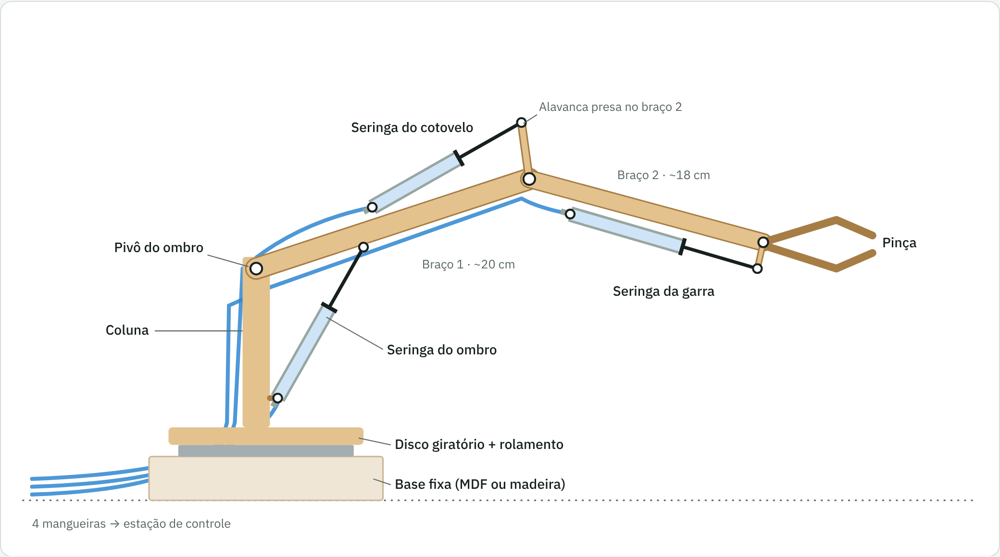
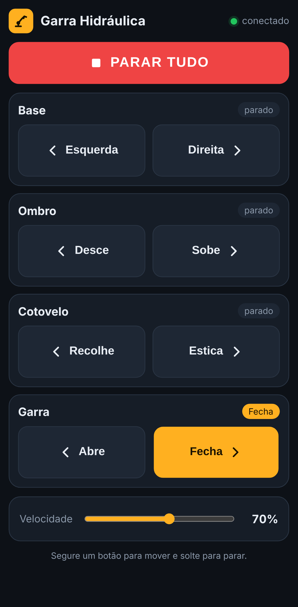
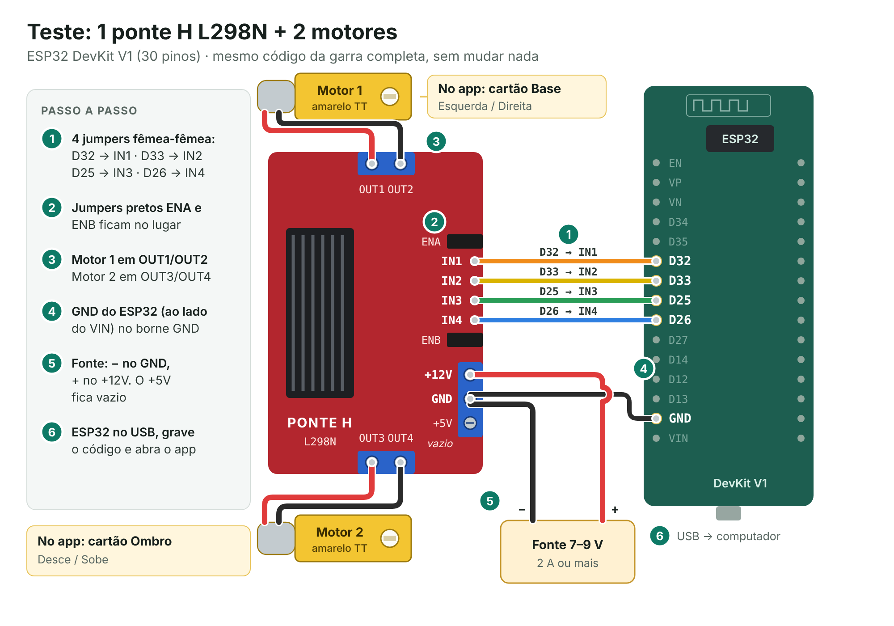

# Garra hidráulica controlada pelo celular

Braço robótico com garra movido por **8 seringas com água** e **4 motores DC**, controlado
pelo **celular** através da rede Wi‑Fi criada por um **ESP32**. Sem internet, sem app de loja,
sem biblioteca extra e sem emendar fios.

<p align="center">
  <br>
  
</p>

```
Celular → Wi-Fi → ESP32 → Ponte H → Motor DC → Manivela → Seringa mestre → água → Seringa escrava → Junta
```

## Só tem 1 ponte H e 2 motores?

Comece pelo **[teste rápido](tutorial/00-teste-rapido.md)**: valida o código com metade das peças,
sem mudar nada no programa.

<p align="center"></p>

## Tutorial passo a passo

| # | Capítulo | O que você faz |
|---|---|---|
| 1 | [Materiais](tutorial/01-materiais.md) | Lista de compras completa |
| 2 | [Preparar a Arduino IDE](tutorial/02-arduino-ide.md) | Instalar a IDE, a placa ESP32 e o driver USB |
| 3 | [Gravar o firmware](tutorial/03-gravar-firmware.md) | Abrir, configurar e gravar o código no ESP32 |
| 4 | [Ligação elétrica](tutorial/04-ligacao-eletrica.md) | ESP32 + 2 pontes H L298N + 4 motores + fonte |
| 5 | [Hidráulica](tutorial/05-hidraulica.md) | Montar os pares de seringas sem bolhas |
| 6 | [Montagem mecânica](tutorial/06-montagem-mecanica.md) | Manivelas, estação de controle, braço, base e pinça |
| 7 | [App do celular](tutorial/07-app-celular.md) | Conectar, controlar e pôr o ícone na tela inicial |
| 8 | [Testes e calibração](tutorial/08-testes.md) | Testar uma etapa por vez |
| 9 | [Problemas comuns](tutorial/09-problemas.md) | Erros da IDE, do celular e da montagem |
| 10 | [Como funciona](tutorial/10-como-funciona.md) | Explicação para relatório e apresentação |

## Resumo rápido

| Motor | Ponte H | Pinos do ESP32 | Botões no app |
|---|---|---|---|
| Base | 1 (IN1/IN2) | 32 · 33 | Esquerda / Direita |
| Ombro | 1 (IN3/IN4) | 25 · 26 | Desce / Sobe |
| Cotovelo | 2 (IN1/IN2) | 23 · 22 | Recolhe / Estica |
| Garra | 2 (IN3/IN4) | 19 · 18 | Abre / Fecha |

- **Rede:** `Garra-ESP`, senha `garra1234`, endereço **http://192.168.4.1**
- **Fonte:** 7–9 V, 2 A ou mais (o L298N perde ~2 V)
- **Código:** um arquivo só, [`firmware/garra_esp32/garra_esp32.ino`](firmware/garra_esp32/garra_esp32.ino)

## Painel web em Next.js

O painel responsivo fica na pasta `app/` e envia os comandos ao ESP32 por um endpoint
intermediário do Next.js. Para executar:

1. Instale o Node.js 20.9 ou superior.
2. No terminal, na pasta do projeto, execute `npm install`.
3. Conecte o computador que executa o Next.js à rede Wi-Fi `Garra-ESP` (senha `garra1234`).
4. Execute `npm run dev -- --hostname 0.0.0.0`.
5. Abra no computador `http://localhost:3000`. Para abrir no celular, conecte-o também à rede
   `Garra-ESP` e use o endereço IP local do computador na porta `3000`.

No PowerShell do Windows, use `npm.cmd` no lugar de `npm` se a política de execução bloquear
o script `npm.ps1`.

Por padrão o servidor encaminha os comandos para `http://192.168.4.1`. Se o ESP32 estiver em
outro endereço, defina `ESP32_URL` no ambiente do servidor. O computador que executa o Next.js
precisa alcançar o ESP32 pela rede local; uma hospedagem externa não consegue acessar diretamente
essa rede. O painel mantém os comandos enquanto um controle estiver pressionado, envia parada ao
soltar e oferece o botão **PARAR TUDO**.

## Estrutura do repositório

```
├── README.md                     ← você está aqui
├── tutorial/                     ← teste rápido + 10 capítulos
├── app/                          ← frontend Next.js + proxy local para o ESP32
├── package.json                  ← dependências e comandos do painel web
├── firmware/garra_esp32/
│   └── garra_esp32.ino           ← código completo (configuração + app + programa)
├── docs/
│   ├── img/                      ← diagramas e telas do app
│   └── diagramas.html            ← todos os diagramas numa página (abra no navegador)
└── platformio.ini                ← opcional, para quem usa PlatformIO
```

## Licença

Livre para copiar, modificar e usar em projetos escolares.
