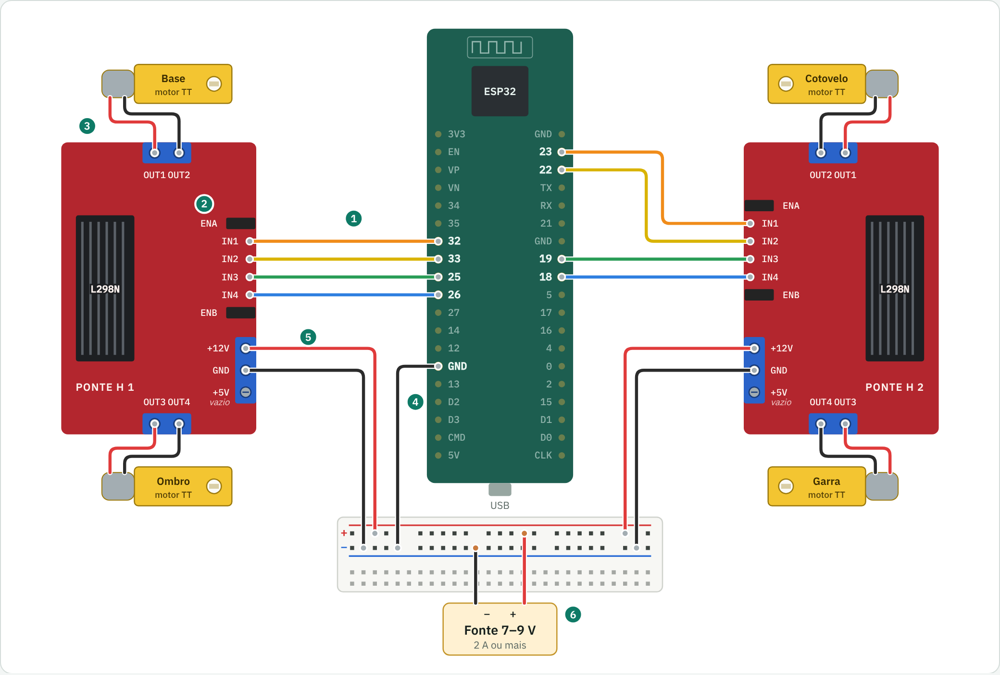
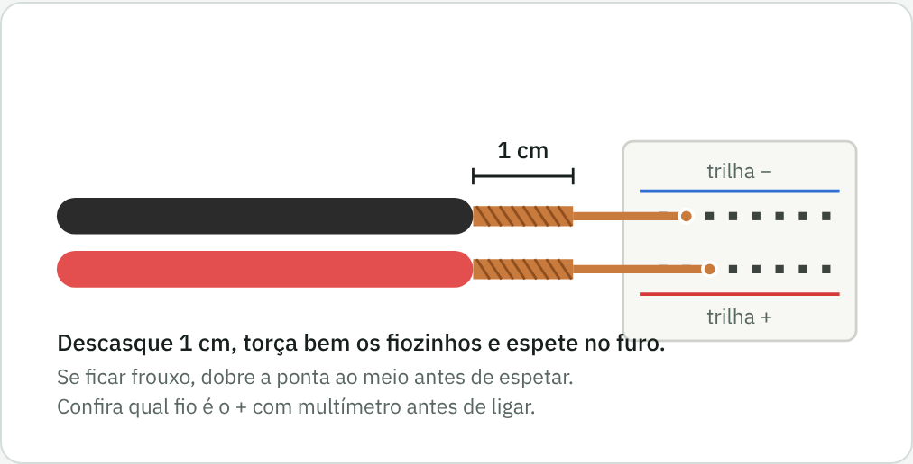

# 4. Ligação elétrica

[← Gravar o firmware](03-gravar-firmware.md) · [Índice](../README.md) · [Próximo: hidráulica →](05-hidraulica.md)

## Por que ponte H?

O motor DC só muda de sentido quando o + e o − dele são invertidos. A ponte H faz essa inversão
sob comando do ESP32. Cada L298N controla 2 motores, por isso são 2 módulos.

## Pinos

| Motor | Ponte H | Entradas | Pinos do ESP32 | Borne do motor |
|---|---|---|---|---|
| Base | 1 | IN1 · IN2 | 32 · 33 | OUT1 · OUT2 |
| Ombro | 1 | IN3 · IN4 | 25 · 26 | OUT3 · OUT4 |
| Cotovelo | 2 | IN1 · IN2 | 23 · 22 | OUT1 · OUT2 |
| Garra | 2 | IN3 · IN4 | 19 · 18 | OUT3 · OUT4 |

A Ponte H 1 usa pinos de um lado da placa ESP32 e a Ponte H 2 do outro lado, então os fios
ficam retos. Em placas diferentes a posição física muda, mas os **números impressos** são os mesmos.

> **ESP32 DevKit V1 (30 pinos):** todos esses pinos existem nela, impressos com "D" na frente
> (D32, D33, D25, D26, D23, D22, D19, D18). O GND do lado esquerdo fica perto do **VIN**, e não
> entre o 12 e o 13 como no desenho de 38 pinos. Siga sempre os nomes impressos na placa.

## Passo a passo (os números batem com o desenho)

1. **Sinais:** 8 jumpers fêmea‑fêmea dos pinos do ESP32 até os pinos IN das pontes H.
2. **Jumpers ENA e ENB:** deixe as capinhas pretas no lugar. Sem elas o motor não gira.
3. **Motores:** os 2 fios de cada motor no borne OUT (solte o parafuso, encaixe, aperte).
4. **GND do ESP32 → trilha −** da protoboard (jumper macho‑fêmea).
5. **Pontes → protoboard:** borne **+12V** na trilha +, borne **GND** na trilha −
   (jumper macho‑macho: uma ponta presa no borne, a outra espetada na trilha).
   O borne **+5V fica vazio**.
6. **Fonte por último:** fio − na trilha −, fio + na trilha +.

## Antes de ligar a fonte na tomada

- [ ] O **GND do ESP32** está na trilha −, junto com o GND das duas pontes (GND comum).
- [ ] Jumpers **ENA/ENB** no lugar nas duas pontes.
- [ ] Borne **+5V** das pontes vazio. Nada ligado no 5V ou 3V3 do ESP32.
- [ ] Fonte de **7 a 9 V**, com o fio + conferido no multímetro.
- [ ] Puxe de leve cada fio: nenhum pode sair do borne.
- [ ] A trilha da protoboard não é cortada no meio (em algumas de 830 furos ela é: ligue as duas metades com um jumper).
- [ ] O ESP32 é alimentado pelo **USB** (computador ou carregador de celular).

> Faça o primeiro teste **sem as seringas**: veja para que lado cada motor gira. Se estiver
> ao contrário do botão, troque os 2 fios dele no borne OUT (ou use `invertido = true`).
