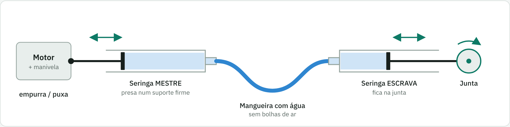

# 5. Hidráulica (seringas)

[← Ligação elétrica](04-ligacao-eletrica.md) · [Índice](../README.md) · [Próximo: montagem mecânica →](06-montagem-mecanica.md)

## Como funciona

A água praticamente não comprime (**princípio de Pascal**). Empurrar a seringa **mestre**
empurra a seringa **escrava** do outro lado da mangueira na mesma medida, e puxar a mestre
puxa a escrava. São **4 pares**, um para cada movimento.

## Montar um par

1. **Encha debaixo d'água.** Mergulhe as duas seringas e a mangueira num pote com água,
   encaixe tudo lá dentro e só então tire. Assim não fica ar.
2. **Deixe os dois êmbolos no meio do curso**, para a junta poder ir para os dois lados.
3. **Prenda a seringa mestre** na estação de controle com 2 abraçadeiras. Se ela se mexer,
   o motor empurra a seringa inteira em vez do êmbolo.
4. **Prenda os êmbolos** (furo + parafuso M3 ou arame em "Z"). Se só encostarem, eles
   empurram mas não puxam de volta.
5. **Mangueira justa no bico.** Na volta (sucção), mangueira frouxa puxa ar. Se precisar,
   passe uma abraçadeira ou cola quente por fora.

## Dicas

- **Ar = garra mole.** Se a escrava demora a responder ou "volta sozinha", tem bolha. Refaça o enchimento.
- **Tamanho das seringas:** mestre **menor** que a escrava dá mais força e menos curso. Iguais = 1:1.
- **Puxar é mais fraco que empurrar.** Monte de modo que o movimento que precisa de força
  (fechar a garra, levantar o braço) aconteça quando a seringa **empurra**. Um elástico ajuda na volta.
- Corante na água ajuda a enxergar bolhas.
