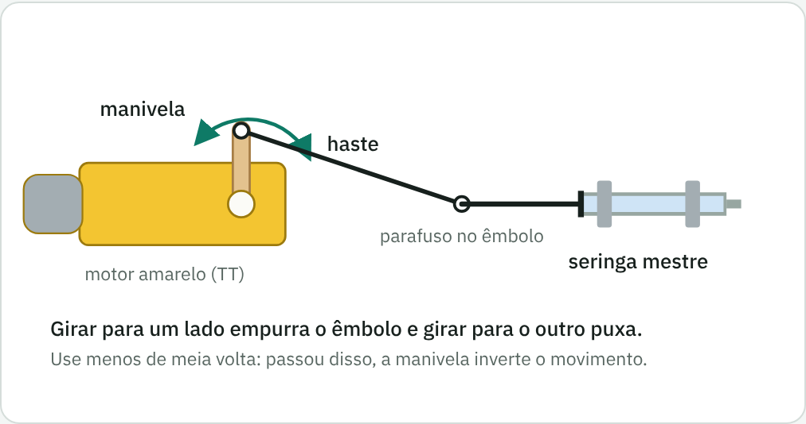
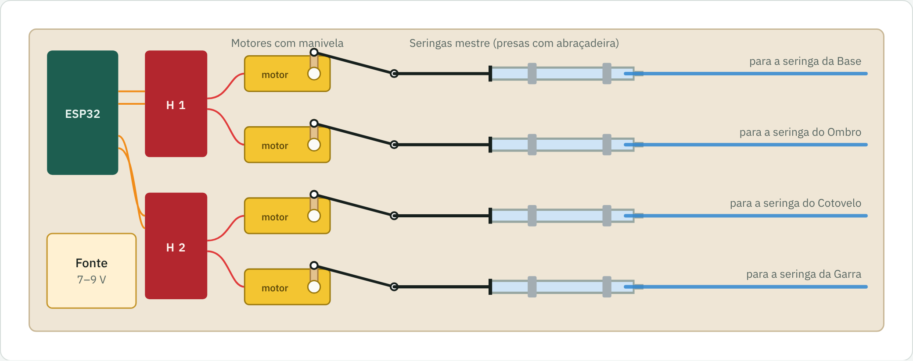
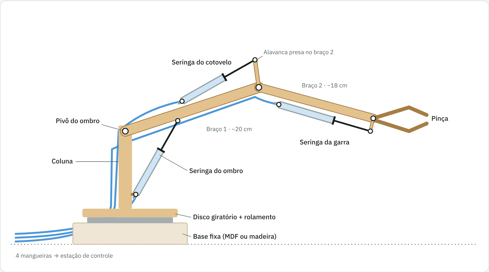
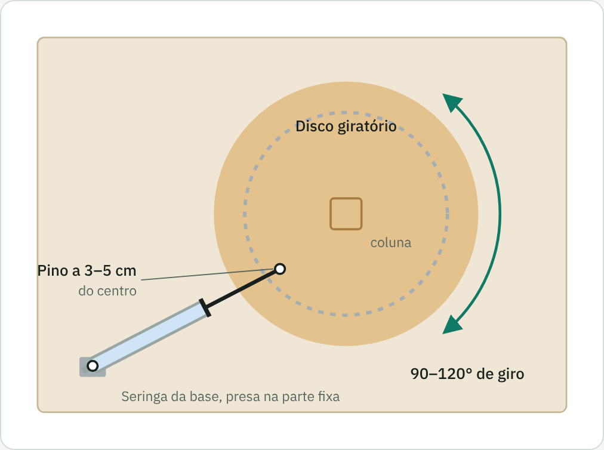
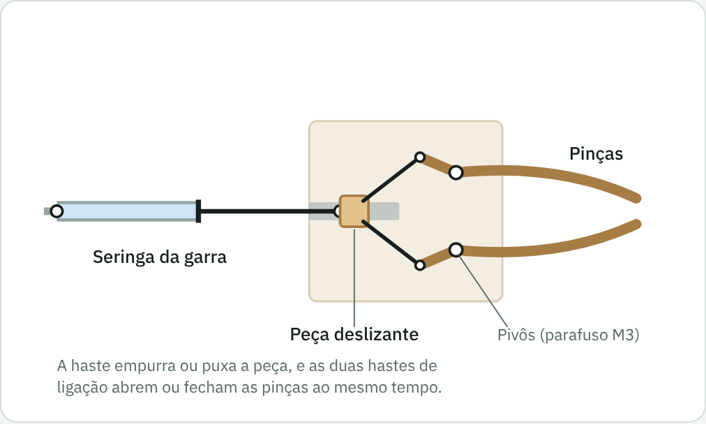

# 6. Montagem mecânica

[← Hidráulica](05-hidraulica.md) · [Índice](../README.md) · [Próximo: app do celular →](07-app-celular.md)

O projeto tem duas partes separadas, ligadas só pelas 4 mangueiras:

- **Estação de controle:** ESP32, pontes H, fonte, motores e seringas mestre.
- **Braço:** base giratória, braços, pinça e seringas escravas.

Se vazar água no braço, ela não chega na eletrônica.

## 6.1 Motor empurrando a seringa (manivela)

- Prenda um braço curto (MDF ou palito, ~2–3 cm) no eixo do motor: é a **manivela**.
- Ligue a ponta da manivela ao êmbolo com uma **haste**, com um parafuso solto (articulado) em cada ponta.
- Girar para um lado empurra o êmbolo, girar para o outro puxa.
- **Use menos de meia volta.** Passando disso, a manivela começa a fazer o movimento contrário.

> Alternativa com mais força: uma **barra roscada** no eixo do motor e uma porca presa no êmbolo.
> É mais lenta, mas segura a posição sozinha quando o motor para.

## 6.2 Estação de controle

## 6.3 Braço

| Movimento | Onde fica a seringa escrava |
|---|---|
| **Ombro** | Entre a coluna e o braço 1. Empurrar levanta o braço |
| **Cotovelo** | Em cima do braço 1, empurrando uma **alavanca curta** presa no braço 2 |
| **Garra** | Embaixo do braço 2, acionando a pinça |

**Importante:** as duas pontas de cada seringa precisam **girar** (parafuso com porca sem
apertar demais). Se ficarem rígidas, a seringa trava quando a junta se move.

Medidas sugeridas para começar: braço 1 ≈ 20 cm, braço 2 ≈ 18 cm. Braço mais longo
alcança mais, mas exige mais força das seringas.

## 6.4 Base giratória

- A seringa fica presa na **parte fixa** e empurra um **pino a 3–5 cm do centro** do disco.
- Isso dá cerca de **90–120° de giro**. Pino mais perto do centro gira mais e tem menos força.
- Use um **rolamento de prato giratório** embaixo do disco: o braço inteiro fica em cima dele.

## 6.5 Pinça

A haste da seringa move uma peça deslizante. Duas hastes de ligação abrem e fecham as duas
pinças ao mesmo tempo, girando em torno de parafusos M3.
