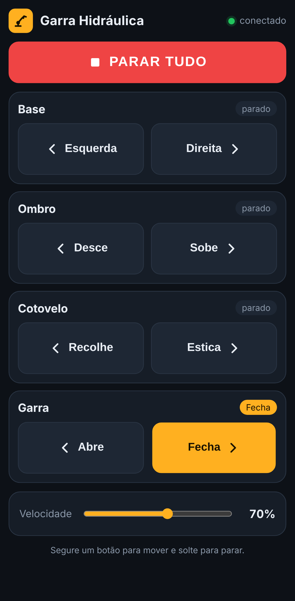
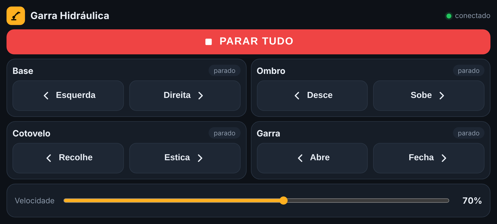

# 7. App do celular

[← Montagem mecânica](06-montagem-mecanica.md) · [Índice](../README.md) · [Próximo: testes e calibração →](08-testes.md)

O app **fica gravado dentro do ESP32**. Não precisa de loja, de instalação nem de internet:
o ESP32 cria a própria rede Wi‑Fi e serve a página de controle.

<p align="center"></p>

## Usar

1. Ligue o ESP32.
2. No celular, conecte na rede **Garra-ESP** (senha `garra1234`).
   Se o celular avisar "sem internet", escolha **manter conectado**. Se a página não abrir, desligue os dados móveis.
3. Abra **http://192.168.4.1** no navegador.
4. **Segure** um botão para mover e **solte** para parar. Dá para segurar dois ao mesmo tempo.

| Controle | O que faz |
|---|---|
| **PARAR TUDO** | Para todos os motores na hora |
| Botões de cada movimento | Base: Esquerda/Direita · Ombro: Desce/Sobe · Cotovelo: Recolhe/Estica · Garra: Abre/Fecha |
| **Velocidade** | Força dos motores, de 30% a 100% |
| Indicador verde | Celular falando com o ESP32 |

Com o celular deitado, os cartões ficam em duas colunas:



## Ícone na tela inicial

- **Android (Chrome):** **⋮ → Adicionar à tela inicial**.
- **iPhone (Safari):** **Compartilhar → Adicionar à Tela de Início**.

Aparece um ícone **"Garra"** que abre em tela cheia, como um app.

## Segurança

- O motor só gira enquanto o botão está apertado. Se o celular parar de mandar o comando
  (botão solto, Wi‑Fi caiu, tela bloqueada, trocou de app), o motor para em 0,4 s.
- Se o botão ficar apertado mais de 6 s seguidos, o motor para e só volta depois de soltar.
  Isso protege o fim de curso da seringa.
- Partida suave (rampa), para não dar tranco na hidráulica.

Como o motor DC não sabe a posição, **é você quem para antes do fim da seringa**.

## Protocolo (para fazer outro controle)

`GET http://192.168.4.1/cmd?c=<comandos>`, com vários comandos separados por `;`.
A resposta é sempre um JSON com o estado.

| Comando | Efeito |
|---|---|
| `m,<j>,1` | motor `j` (0 a 3) no sentido do botão da direita |
| `m,<j>,-1` | motor `j` no sentido do botão da esquerda |
| `m,<j>,0` | para o motor `j` |
| `v,<30-100>` | velocidade em % |
| `x` | PARAR tudo |
| `p` | ping |

Enquanto o motor deve girar, o comando `m` precisa ser repetido a cada ~150 ms.

Exemplo de resposta:
```json
{"v":70,"j":[{"n":"Base","m":"Esquerda","p":"Direita","d":0,"t":false}, ...]}
```
(`d` = sentido atual, `t` = parado por tempo máximo)
